Usage
=====

Runmanager is the primary means of defining and managing the set of experiment parameters
(global variables, or globals) used in the labscript experiment logic. Runmanager also
handles the creation of each hdf5 shot file, and the invocation of labscript via the execution
of a user specified labscript experiment logic file.

The graphical interface
-----------------------

The current runmanager configuration and the controls for generating new shots are
in a toolbar at the top of the runmanager interface, which is always visible. These comprise
(as labelled in :numref:`fig-overview`):

.. _fig-overview:

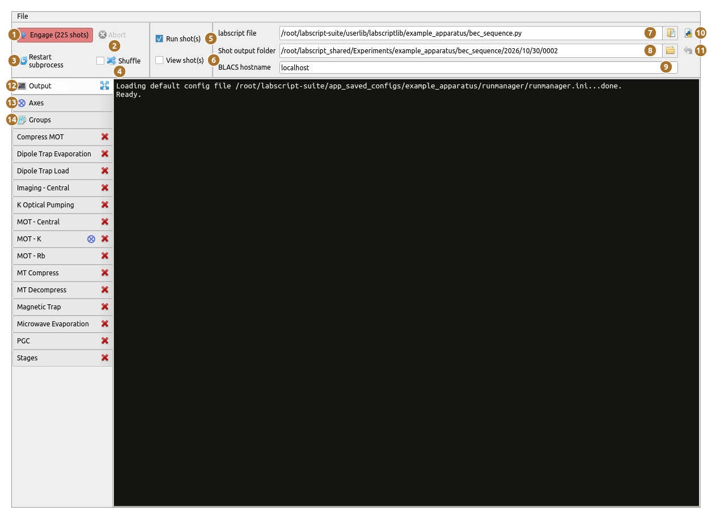

    The runmanager graphical interface with the main controls labelled as per the
    below text. The ‘output’ tab is currently shown.

#.  The engage button: This begins production of the appropriate number of shot files.
    The number of shot files that will be produced is displayed prominently in the button
    text so that any mistakes made when defining the parameter space scan can be quickly
    corrected prior to beginning shot generation. This button can also be ‘clicked’ via the
    F5 key on a keyboard.
#.  The abort button: This stops the production of shot files prematurely, and
    interrupts the compilation of the shot in progress.
#.  The restart subprocess button: Primarily for debugging and for use during labscript
    development, this button restarts the subprocess that manages the execution of the
    labscript experiment logic file, which in turn generates and stores hardware instructions
    inside the hdf5 file (see :ref:`usage:Shot creation`).
#.  The shuffle checkbox: This checkbox controls the global setting for whether parameter
    space scans are shuffled or not. This is a tri-state checkbox (all-some-none) displaying
    the current shuffle state on the axes tab. Clicking the checkbox will overwrite the
    state of each entry on the axes tab with the new state of the global checkbox. For
    more details, see :ref:`usage:Parameter space scans`.
#.  The run shots checkbox: If ticked prior to clicking the engage button, shot files will
    be sent immediately to the BLACS queue once the hardware instructions have been
    generated by labscript.
#.  The view shots checkbox: If ticked prior to clicking the engage button, shots will be
    sent to runviewer once the hardware instructions have been generated by labscript.
    Runviewer is assumed to be running locally, and will be launched if it is not already
    running once the first hdf5 file has been generated.
#.  The labscript file: The Python file containing the experiment logic to be compiled
    into hardware instructions (see :doc:`labscript <labscript:index>`).
#.  The shot output folder: The location to store the hdf5 shot files. The default
    folder is `<experiment_shot_storage>/<script name>/<subfolder>`, where
    `experiment_shot_storage` is set in the laboratory PC configuration file (see
    :doc:`labconfig <labscript-utils:labconfig>`), `<script name>` is the name of the
    experiment logic file without its extension, and `<subfolder>` is given by
    `output_folder_format` in the `[runmanager]` section of the labconfig, which is by
    default `%Y/%m/%d/{sequence_index:05d}`: the date and the index of the sequence on that
    day. The file name of each shot is `filename_prefix_format` from the same section, by
    default `{sequence_timestamp}_{script_basename}`, followed by the shot number. While
    the folder is the default, runmanager updates it when the date or the sequence index
    changes, so that each sequence is in a folder of its own. If BLACS or lyse run on
    another computer, the folder must be on a drive that is shared with that computer
    (see `shared_drive` in :doc:`labconfig <labscript-utils:labconfig>`).
#.  The BLACS hostname: The network hostname of the PC the hdf5 shot files are to
    be sent to if the ‘run shots’ checkbox is ticked. It is expected that BLACS is running
    on the specified PC, and that network access (including firewalls and other network
    access controls) is configured appropriately.
#.  The open in editor button: This button opens the labscript experiment logic file in
    the text editor given by `text_editor` in the `[programs]` section of the laboratory
    PC configuration file (see :doc:`labconfig <labscript-utils:labconfig>`), or in the
    operating system's default program if `text_editor` is empty.
#.  The reset shot output folder button: This button resets the shot output folder to
    the default. This re-enables the automatic update of the folder, which is disabled
    for a folder that the user has chosen.

The rest of the runmanager interface is a set of tabs. The first 3 tabs contain
further runmanager specific controls:

12. The output tab: This tab contains the terminal output of the shot creation process
    including the terminal output produced during the execution of the labscript experiment
    logic file. For example, Python `print` statements included in
    the experiment logic code will appear here during shot creation. Warnings and error
    messages generated by the labscript API also appear here in red text. The button on
    the tab moves the output into a separate window, so that it can be visible at the same
    time as another tab, and back.
13. The axes tab: This tab allows the user to control the iteration order of the parameters
    in the defined parameter space (see :numref:`fig-axes`). The length of each axis of the
    parameter space is displayed, as is a shuffle checkbox for determining whether the
    points along that axis should be shuffled before the parameter space is expanded into
    the set of shots to be created. The global shuffle control (see item 4 in this list) is
    linked to the state of the shuffle checkboxes on the axes tab. This feature is
    described further in :ref:`usage:Ordering and shuffling`.
14. The groups tab: This tab manages the hdf5 files that store the globals (see :numref:`fig-groups`). 
    Further details on managing global variables will be discussed in :ref:`usage:Managing global variables`.

These tabs are then followed by an arbitrary number of tabs containing sets of global
variables, which will be discussed further in :ref:`usage:Managing global variables`.

.. _fig-axes:

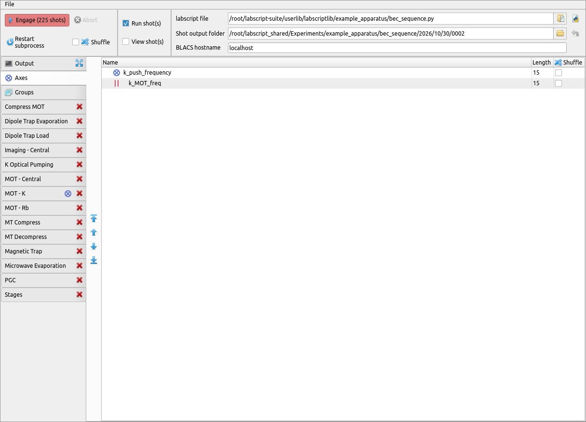

    The ‘Axes’ tab of runmanager. This tab displays a list of all global variables
    (indicated by the blue outer product icon) or groups of global variables (indicated by the
    icon with red parallel bars) that form axes of the parameter space that will be scanned over
    (see item 13 and :ref:`usage:Parameter space scans` for further details). The order of the axes
    can be changed using the controls to the left of the list, which sets the order in which the
    outer product of the axes is performed (when generating the shot files).

In addition to this, runmanager can save and restore the entire GUI state via the
relevant menu items in the ‘File’ menu. This allows rapid switching between different types
of experiment logic and/or globals files. [1]_ This is particularly useful for shared experiment
apparatuses, where different users want to run different experiments, and for the cases
where a user wishes to rapidly switch between one or more diagnostic configurations they
have previously saved.

Managing global variables
-------------------------

Runmanager provides a simple interface for grouping and modifying global variables. As
mentioned previously, the ‘groups’ tab in runmanager handles creating and opening the
hdf5 files that store the global variables. There are two levels of organisation for global
variables:

* at the file level (globals can be stored across multiple files, the union of which is used
  to generate shots), and
* groups within each file.

.. _fig-groups:

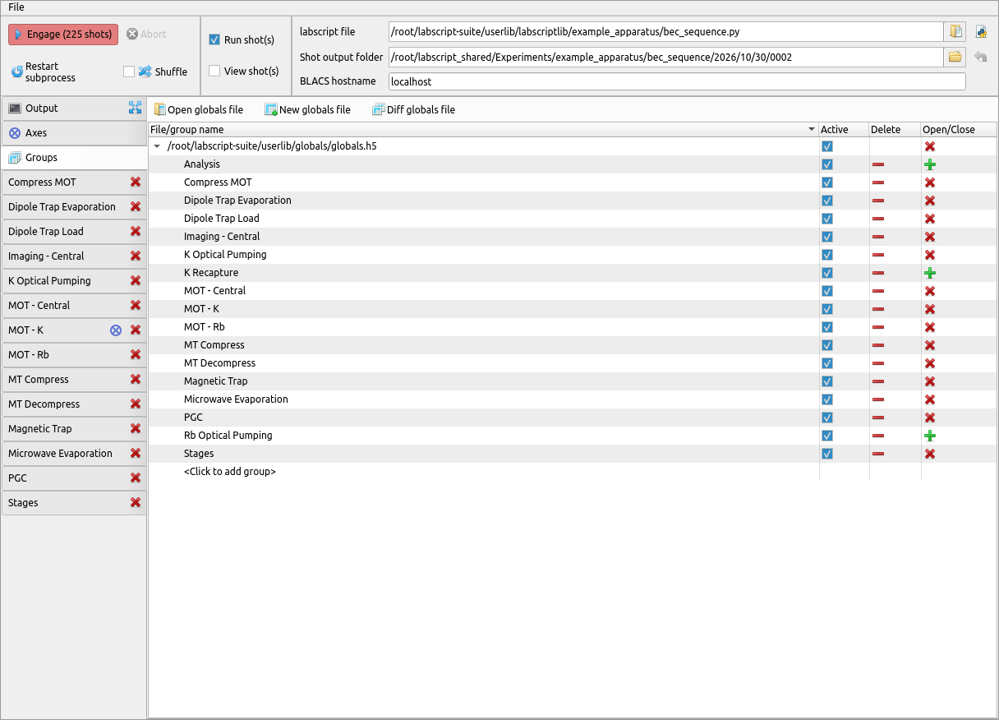

    The ‘Groups’ tab of runmanager. This tab displays the groups of global
    variables (stored in hdf5 files) that have been loaded into runmanager. From this tab,
    users can enabled/disable the use of these globals when compiling shots (using the ‘active’
    checkboxes) and open/close an editing tab for each group. The editing tabs, when open, are
    displayed as additional tabs on the left most edge of the runmanager interface. See :ref:`usage:Managing global variables`
    for further details on managing globals.

The ‘New globals file’ and ‘Open globals file’ buttons on the groups tab create a globals
file or load an existing one. The `<Click to add group>` row under a file creates a group
in that file and opens a tab for it. The open/close button of a group opens or closes its
tab, and the delete button deletes the group from the file after a confirmation. Closing a
tab does not change the globals in it.
In a group's tab, the `<Click to add global>` row adds a global.

Globals groups can have arbitrary names (including spaces and special symbols). The only
requirement is that a group name is unique within its file (it can however have the same
name as a group in a different file).
Globals within a group are then only used in the creation of shots if the ‘active’ checkbox
for the group is checked on the groups tab (see :numref:`fig-groups`). This provides a simple way
of switching between different groups of globals, allowing labs to maintain a common set
of parameters for their experiments as well as individual parameter sets for specific users
and/or experiments. For example, rather than modifying a set of globals in a group, a user
could instead deactivate the group containing those globals, and instead ask runmanager to
pull those globals from a separate file.

Each group of globals can be opened for editing in a new tab, which has columns
for the global name, value, units and expansion. The global name must be a :doc:`valid Python variable
name <python:reference/lexical_analysis>` that is not a Python keyword, and must not be the
name of a Python builtin or a name defined in the `labscript.labscript` module, which
includes every name that `from labscript import *` provides. Runmanager checks only that
the name is a valid identifier; labscript checks the rest when it compiles a shot, so
that the globals can be injected into the labscript experiment logic
(see :doc:`labscript <labscript:index>`) without replacing existing names. The global name
must also be unique across all active groups, as global groups are joined into a single set
before passing the globals into the labscript experiment logic.

The value of a global can be any Python expression (including the use of functions from
the numpy module, as `np`), that evaluates to a datatype supported by hdf5, such as, but not
limited to:

* a number: `1234` or `780e-9`,
* a string: `'N_atoms'`,
* a list or numpy array (which will be treated as an axis of a parameter space to scan,
  where the global variable will contain only one of the elements of the list or array in
  each shot): `[1, 2, 3]` or `np.array([1, 2, 3])`,
* a tuple (which despite being list like, will not be treated as an axis of a parameter
  space to scan and will instead be passed into labscript as the tuple specified): `(1, 2, 3)`,
* a Boolean: `True` or `False`
* an equation: `1+2`
* a Python inbuilt, or numpy, function call that returns a valid value: `np.linspace(0, 10, 10)`,
* an expression that references another defined global variable by name (the value
  of this global variable is used in its place): `2*other_global` or `np.linspace(0, 10, other_global)`,
* a Boolean expression: `(other_global1 and other_global2)` or `(other_global3 == 7)` 
  or `(other_global4)`, or
* any of the above plus a Python comment: `780e-9 #This was previously 781e-9`.

Comments are shown in grey, both in the table and while a value is being edited.

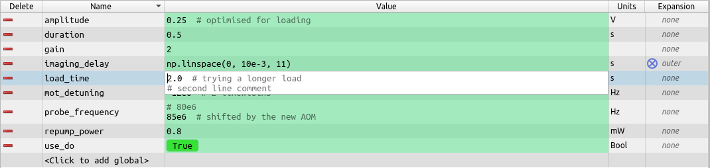

    Comments in grey in the values of globals and in the editor.

The expressions are evaluated in a namespace that holds the other globals and the
following names. A global takes precedence over all of them, and each item of the list
takes precedence over the items after it:

* the names of the file given by `globals_namespace` in the `[runmanager]` section of the
  labconfig, if it is set: the names in its `__all__`, or if it has none, the names that do
  not start with an underscore. Runmanager runs the file each time it evaluates the
  globals. If the file cannot be run, every global holds the error,
* numpy, as `np`, the units `ns`, `us`, `ms`, `s`, `Hz`, `kHz`, `MHz` and `GHz`, which are
  the factors that convert a quantity in that unit to seconds or hertz, and the functions
  `quadspace(t_min, t_max, n_points, randomise=False, repeats=1)`, which returns
  `n_points` values from `t_min` to `t_max` that are equally spaced in their squares, and
  `first()`, an iterator that yields `True` and then `False` forever,
* the names of `from pylab import *`, unless `pylab_namespace` in the `[runmanager]` section
  of the labconfig is `False`. Runmanager will stop providing these names in a future
  version. A global that uses one of them is highlighted in amber, with a warning in its
  tooltip that names the replacement, such as `np.linspace` for `linspace`, and the
  warnings are printed in the output box when shots are compiled. `sum`, `any`, `all` and
  `divmod` from pylab are the numpy functions; without pylab they are the Python builtins,
* the Python builtins.

Runmanager records, in the globals file, the values of each global that have been used to
compile shots, and the time at which each was last used. The drop-down button at the right
of a value cell, or Alt+Down, lists them: the current value first, then the most recently
used of the other values, then values that have been pinned, then the others, in order of
how often and how recently they were used. Values that differ only in their comments or
whitespace are one entry, which keeps the most recent comment. Type in the box at the top
of the list to filter it, and choose a value with Enter or a click. Ctrl+P pins and unpins
the selected value, and Delete removes it from the list. Each value is listed with the
expansion setting that the global had when the value was used, shown as it is in the
table: in grey italics if runmanager set it automatically. Choosing a value restores its
expansion setting as well; an automatic setting is set again from the new value. The
right-click menu item *Switch selected global(s) to previous value* sets each selected
global to the most recently compiled of its other values. Using it, then compiling, then
using it again switches a global back and forth between two values.

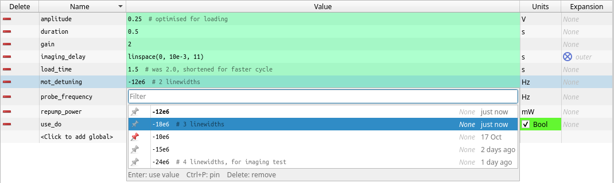

    The values of `mot_detuning` that have been used to compile shots, each with the
    expansion setting that the global had when the value was used. The current value is
    first, in bold. The selected value, `-18e6`, is the most recently used of the others,
    and `-10e6` is pinned.

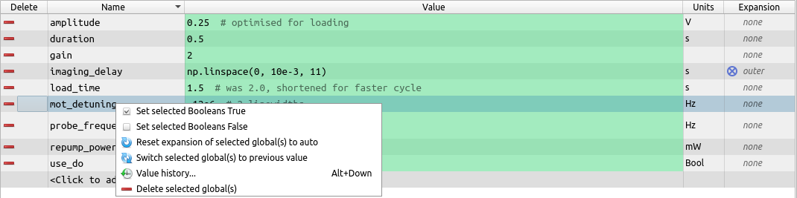

    The right-click menu of a global, with the items for its value history.

As these expressions can become quite complex (see :numref:`fig-complex-globals`), the tooltip for the value
cells displays the evaluated result of the Python expression. The value cell is also colour
coded to the successful evaluation of the expression, so that mistakes can be easily identified
(see :numref:`fig-evaluation-error`).

.. _fig-complex-globals:

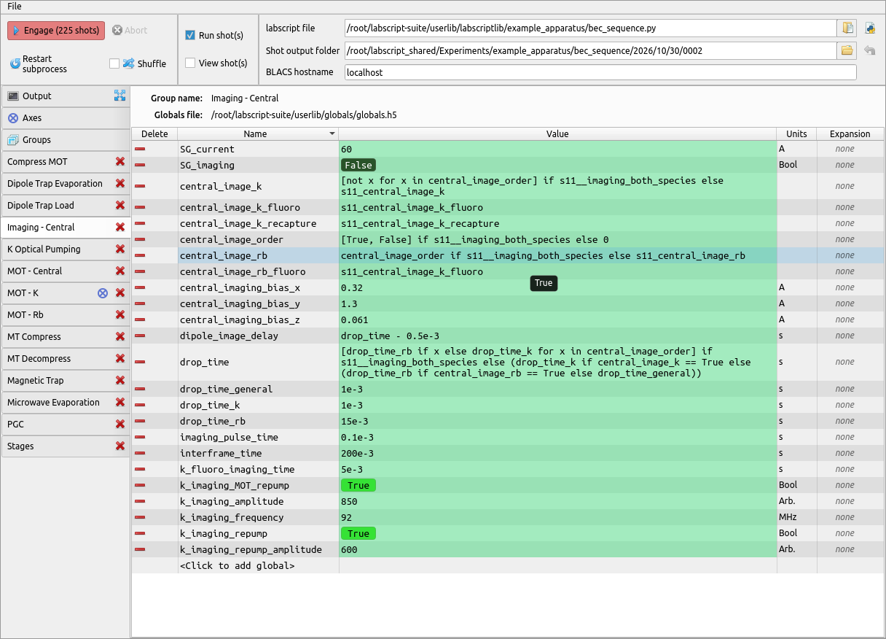

    An example of complex global variables that utilise Python expressions to define their value.
    Note, for example the `drop_time` global variable, whose full expression is shown below. The
    `drop_time` used is always drawn from one of three global variables, but the global variable selected
    is determined by a separate global variable (a Boolean) and may contain a list of drop times if
    the user wishes to image multiple species. In the case of the expression generating a list, this
    global becomes an axis of a parameter space, running two shots for every other data point in the
    parameter space (one shot to image each of the two species of the experiment). Such an
    expression could not be defined within experiment logic as parameter spaces must be defined within
    runmanager, not labscript. In order to simplify the view of globals with complex expressions, the
    tooltip (shown for the `central_image_rb` global) shows the value(s) the global will take in the next
    compiled shot(s).

.. code-block:: python
    :caption: Full expression for `drop_time` global 

    [ drop_time_rb if x else drop_time_k for x in central_image_order ] if
    s11__imaging_both_species else ( drop_time_k if central_image_k == True
    else ( drop_time_rb if central_image_rb == True else drop_time_general))

The units of the global are not currently passed into the labscript experiment logic
code, but are a way to provide context to the user within runmanager. For example, if the
labscript experiment logic multiplied a global variable for a frequency by `1e6` everywhere
it was used (or the keyword argument `units="MHz"` was used everywhere), then you could
type ‘MHz’ into the units column of runmanager so that a later user would know that the
global was expected to be of that magnitude and would not accidentally enter it in kHz
or Hz. In addition to this, globals whose values are explicitly specified as either `True` or
`False`, optionally followed by a comment, have their units automatically set to ‘Bool’, and
the value is drawn as a button, bright green for `True` and dark green for `False`, which
toggles the value when clicked. Clicking elsewhere in the cell edits the value. Boolean
globals can be used to enable or disable stages of the experiment logic (see
:numref:`fig-bools`).

.. _fig-evaluation-error:

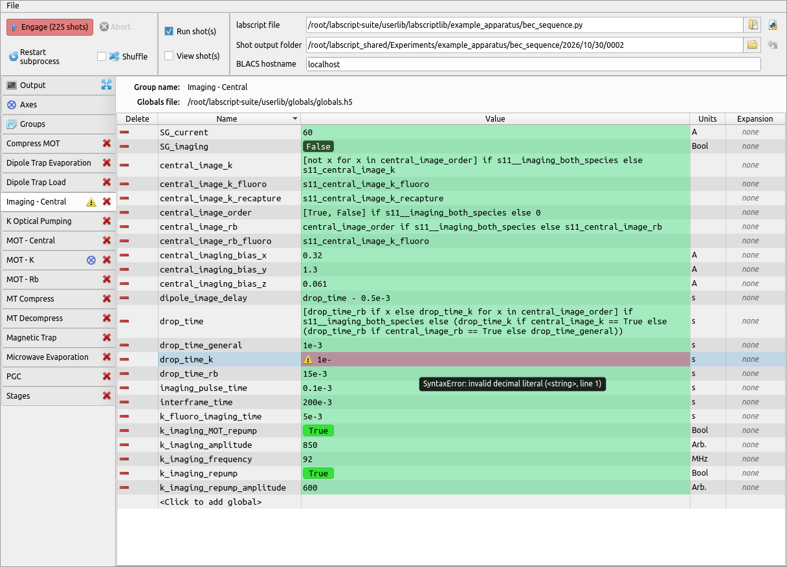

    An example of an evaluation error in a global variable. The user is notified of
    the error in two places: an icon appears next to the tab name and the global in question is
    highlighted in red. The tooltip displays the cause of the error, in this case a Python syntax
    error.

The storage format for the globals is identical to that in any shot, so a shot file can be
loaded as a globals file (even one that has been executed and analysed). However, any
modification to globals then modifies that shot file, and so partially destroys the record
of the experiment. [2]_ Loading a shot file is therefore best used only to look at the
globals of an old shot, or to compile new shots with its globals without modifying them.

.. _fig-bools:

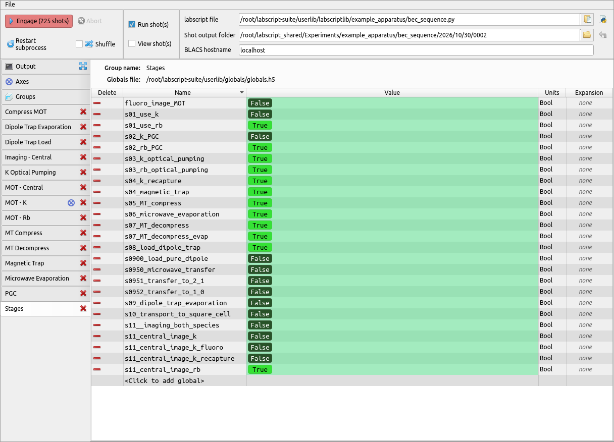

    An example of how a labscript experiment can be parameterised by a series
    of Boolean global variables. Here the production of a BEC is split into several stages.
    Each global has a prefix that increments, which keeps the globals in the order of the
    stages. Runmanager detects the Boolean type of the global, and provides a
    button in the value column that toggles it. With each global used in the labscript
    experiment logic file as the condition of an if statement, each stage of the BEC
    production process can be turned on or off.

Parameter space scans
---------------------

Runmanager scans a parameter space by expanding the globals whose values are lists into
the axes of that space.

How expansion works
~~~~~~~~~~~~~~~~~~~

A sequence is made of axes. Each axis is a list of points, and each point gives a value
to one global, or to several globals that vary together. The shots of the sequence are
every combination of one point from each axis, so the number of shots is the product of
the lengths of the axes. An axis may have one point, or none, in which case the sequence
has no shots.

The expansion column of each global holds its expansion setting, which is one of:

* ‘none’: the value is passed to every shot as it is, even if it is a list.
* ‘outer’: the global is an axis of its own, and each shot gets one element of its value.
* The name of a zip group, after the Python function `zip`: the global varies in lockstep
  with the other globals in the zip group, which together are one axis. The globals of a
  zip group must have equal lengths. An ‘outer’ global and a zip group that has the name
  of that global are one axis.

Each setting is either automatic, which is shown in grey italics, or chosen by you, which
is shown in the normal text colour. Editing the expansion column gives a list of the
choices: ‘auto’, ‘none’, ‘outer’ and the zip groups in use, and a new zip group name can
be typed. ‘auto’ (or an empty entry) returns the global to the automatic setting, as does
‘Reset expansion of selected global(s) to auto’ in the right-click menu. A setting that you choose is recorded
as such in the globals file and is kept until you return the global to ‘auto’.

Runmanager works out the automatic settings after every evaluation of the globals:

#.  A global whose value is a list, array or range [3]_ is ‘outer’. Any other value,
    including a tuple, gives the setting ‘none’.
#.  A list that is derived from a global on an axis, directly or through other lists with
    automatic settings, is put on the axis of that global: in its zip group if it is in
    one, and otherwise in a zip group named after it. If the global that it is derived
    from has an automatic setting, that global is put in the same zip group. For example,
    with ``amplitude = [0.1, 0.2, 0.3]`` and ``power = [a**2 for a in amplitude]``, both
    globals are in zip group ``amplitude``, and in each shot ``power`` is the square of
    ``amplitude``. This is the same when you have set ``amplitude`` to ‘outer’ or put it
    in a zip group: ``power`` follows it.
#.  A global that you have set to ‘none’ is not on an axis, so rule 2 does not apply to the
    lists that are derived from it. Such a list is ‘outer’ by rule 1, and the lists that
    are derived from it follow it by rule 2.

Choosing a setting for a derived list overrides rule 2. If you set ``power`` to ‘outer’,
it is an axis of its own, the sequence has every combination of a value of ``power``
with a value of ``amplitude``, and in most of the shots ``power`` is not the square of
``amplitude``.

Runmanager reports an error, with the global's value cell in red and the error icon on
the group's tab, for:

* a global with an expansion setting whose value cannot be iterated over,
* globals in a zip group that have unequal lengths, and
* a global in a zip group that refers to a global on another axis (see
  :ref:`usage:Evaluation of globals`). A list that is derived from lists on two
  different axes gets this error.

The number of shots is shown on the engage button, and the axes tab lists the axes with
their lengths (see :numref:`fig-axes`). The tab of each group that contains a global that
is scanned over shows the outer product icon, or the zip icon if all such globals in the
group are in zip groups. The tab's tooltip lists these globals with the number of values
of each. A global that is derived from another global in the same zip group is not
counted as scanned over. A tab with an evaluation error shows the error icon instead.

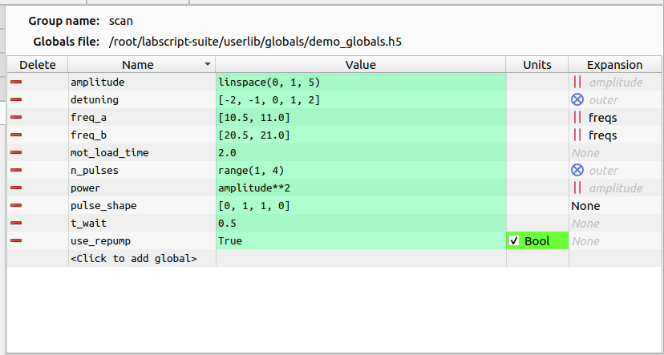

    A scan group. ``amplitude`` and the ``power`` derived from it are zipped
    automatically, ``detuning`` and the range ``n_pulses`` are outer automatically,
    ``freq_a`` and ``freq_b`` are in a zip group that the user chose, the list
    ``pulse_shape`` is passed as a single value because the user chose ‘none’, and
    the single values have no expansion automatically.

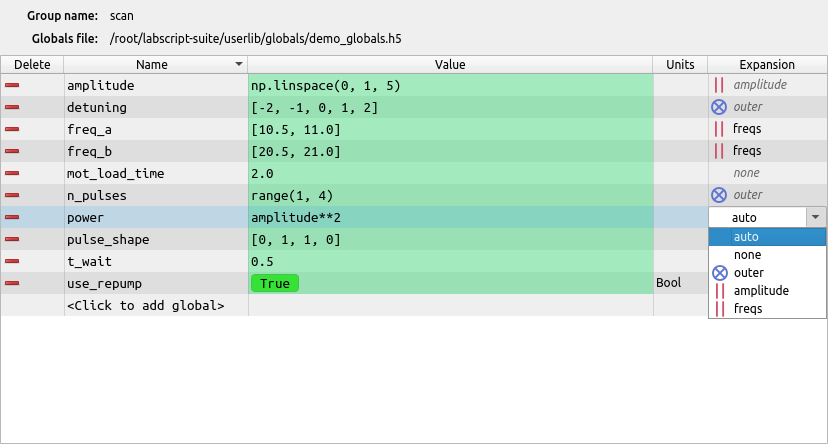

    Editing an expansion setting.

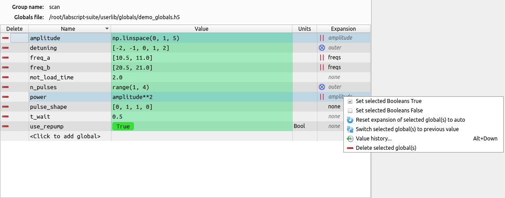

    The right-click menu returns the selected globals to auto.

Ordering and shuffling
~~~~~~~~~~~~~~~~~~~~~~

The axes tab sets the order in which the axes are combined when the shots are produced
(see item 13 in :ref:`usage:The graphical interface`). The values of each axis can be shuffled, on
a per axis basis, and the whole set of shots that spans the parameter space can also be
shuffled.

Consider the following example. Many of the early stages of BEC production (for
instance the MOT or magnetic trap stages) should be optimised for best phase-space density.
Phase space density is calculated from several parameters; the most important being atom
number and atom cloud temperature. While atom number can be easily measured from
an absorption image from a single shot, temperature is most commonly determined from
analysing the result of multiple shots. In this case, the drop time (the time between releasing
the atoms from the trap and taking the absorption image) is varied for each shot and the
temperature determined by fitting to the linearised relationship between atom cloud size
and drop time. Already, it can be seen that measuring the phase space density for a single
set of parameters requires several shots, which can be easily automated by giving the drop
time a list of values.

Now consider the optimisation of MOT or magnetic trap parameters. Many of these are
coupled and can not be independently optimised. As such, it is preferable to optimise two
or three variables at once, measuring the phase-space density at each point to determine the
optimal set of parameters. Such a parameter space typically takes several hours to complete
due to the large number of shots that must be run. A BEC apparatus is likely to undergo
systematic drifts during this time, which may invalidate the results. However, with careful
thought, the ordering and shuffling of the axes can be used to counteract this. For
example, systematic drift will effect the linearity of the data when determining
temperature, especially if the acquisition of each data point is separated by a
significant period of time. However, by defining the
drop time to be the inner most item of the outer product, you ensure that all shots needed
to determine the phase-space density for a single set of MOT parameters are executed as
close together in time as possible. Shuffling the order of the drop time then eliminates short
term systematic drift, as does separately shuffling the order of the values in each remaining
axes of the outer product (the MOT parameters). If long term systematic drifts need to
be quantified, then an additional axes to the outer product can be added at the outer most
layer in order to repeat each of the shots a prescribed number of times (by defining an
additional ‘dummy’ global variable as `range(N)` where `N` is the number of times to repeat
each shot).

To run this in runmanager, the user defines the list of values to scan over for each parameter, sets the order
in which the outer product should use each axis, and specifies whether the values for each
axis should be shuffled. Once done, clicking the engage button generates the sequence of
shots and sends them to BLACS to be executed on the experiment.

Evaluation of globals
---------------------

All global variable expressions are automatically evaluated after a change to any global
variable. This serves to both update the tooltip with the result of the expression, detect
axes of a parameter space to scan (and group them into zip groups if appropriate) and
warn the user of any errors during the evaluation of the globals. Global variable
expressions can reference other global variables, so a set of parameters and the
quantities derived from them can be recorded without storing any parameter more than once.
The derived quantities are then saved in each shot file, where they are available to
analysis (see :doc:`lyse <lyse:index>`).

Each global is evaluated once for the whole sequence, not once per shot: in the expression
of a global that refers to a list, the name of the list has the whole list as its value. A
global in a zip group therefore varies only with the other globals in its zip group, and
runmanager reports an error for a global in a zip group that refers to a global that is
expanded on a different axis (an ‘outer’ global or a global in another zip group), either
directly or through globals that are not expanded. A quantity that depends on several axes
of a scan can be computed in the experiment script, where each global has a single value.

To implement this, each expression is parsed with the Python ``ast`` module to find the
names of the other globals that it refers to, and the expressions are then evaluated in an
order in which every global comes after the globals it refers to, each in a namespace that
also holds the names described in :ref:`usage:Managing global variables`. This gives a
mapping of each global variable to the names of the global variables that it depends on,
which is used for descriptive error messages and for automatically detecting which globals
should be combined into zip groups.
Each expression is evaluated once. Globals that refer to each other in a cycle are reported
as an error naming the cycle, and a global that refers to a global with an error gets an
error of its own.

The hierarchy of global interdependencies is then used to work out the automatic expansion
settings described in :ref:`usage:How expansion works`. A list that is derived from globals
on several axes is put on the axis of the alphabetically first of them, and gets an error
naming the others. The automatic settings are recomputed from the values and the
hierarchy after every evaluation.

Shot creation
-------------

Runmanager runs the labscript experiment logic file in a separate Python process, the
‘compilation subprocess’, so that errors in the experiment logic do not affect runmanager.
The subprocess is started with runmanager and is used for every shot; the ‘Restart’ button
starts a new one. Modules that the experiment logic imports stay imported between shots,
and are reloaded when their files change.

To generate shot files, runmanager:

#.  Re-evaluates all globals (see :ref:`usage:Evaluation of globals`). This both determines the number of shots to
    produce, and generates the evaluated set of global variables for each shot.
#.  Writes the globals to hdf5 files, one file for each shot. The unevaluated globals are
    also written into every hdf5 file, in order to provide a complete record
    of the experiment (the unevaluated globals contain information about the parameter
    space that is not available when looking at the single point of parameter space in the
    evaluated globals of a single shot file).
#.  In a thread, which keeps the GUI responsive, sends the file paths one at a time to the
    compilation subprocess.

For each shot file, the compilation subprocess:

#.  Calls `labscript.labscript_init`, which tells labscript the hdf5 file to write hardware
    instructions to, saves the state of the Python builtins, and adds the globals of the
    shot to the builtins.
#.  Executes the labscript experiment logic file (using the Python function `exec`) as
    the `__main__` module, with the directory of the file as the working directory. The
    experiment logic calls the labscript API, which generates the hardware instructions
    and saves them in the hdf5 file. Terminal output (for example, `print` statements) is
    sent back to runmanager and shown in the output tab.
#.  Calls `labscript.labscript_cleanup`, which restores the Python builtins, so that the
    globals of one shot are not present in the next, and resets the internal state of
    labscript. The namespace of the `__main__` module is also cleared.

Once shot files are created, the file paths are sent to runviewer or BLACS, as determined by
the checkboxes in the runmanager GUI, for viewing and/or executing the shots respectively.

.. rubric:: Footnotes

.. [1] For clarity, the values of the globals are not saved in this configuration file, but simply the location
    of the hdf5 file containing the globals. This means that any globals in files shared between saved
    runmanager configurations will share their values. For cases where global values should differ between
    runmanager configurations, separate globals files should be used.

.. [2] Note that in an executed shot file, globals exist in two formats: the evaluated format (one point in the
    parameter space) used by labscript, and the raw strings as displayed in runmanager. Only the latter
    are overwritten if the globals are edited in this way.

.. [3] Python lists and numpy arrays are both called ‘lists’ in this section.
